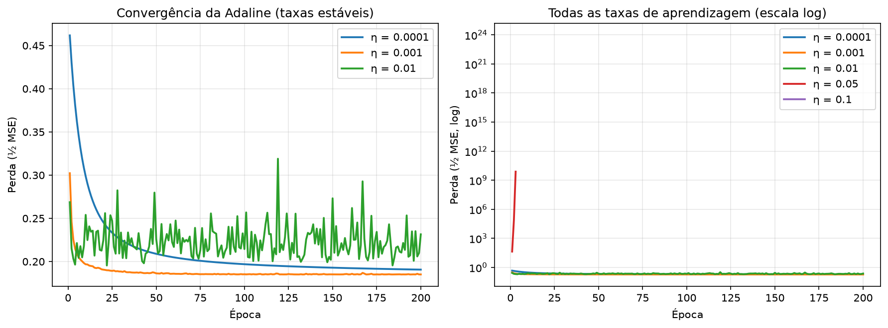
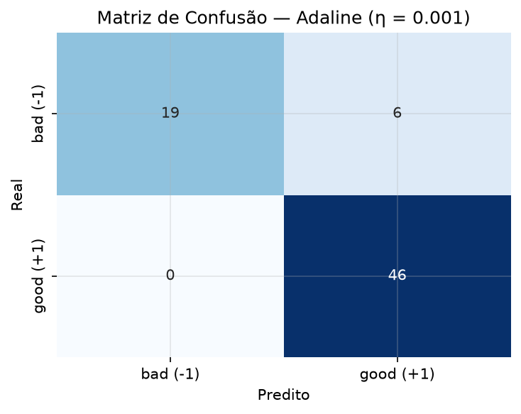

# Problema 1 — Rede Adaline para Classificação de Retornos de Radares Ionosféricos

Os cálculos, gráficos e saídas completas estão no [notebook](problema1.ipynb).

## 1. Preparação dos Dados e Justificativa Algébrica da Normalização

O conjunto *Ionosphere* possui **351 amostras** e **34 atributos contínuos**, com **225 amostras** da classe `good` (`+1`) e **126 amostras** da classe `bad` (`-1`):

- **Valores ausentes:** `0`.
- **Atributos constantes removidos:** atributo de índice `1` (2ª coluna, composto integralmente por zeros), restando **33 atributos** informativos. A remoção prévia evita divisão por zero ($\sigma_j = 0$) na padronização *Z-score*.
- **Divisão e padronização:** separação estratificada em **80% treino (280 amostras)** e **20% teste (71 amostras)** com semente fixa (`42`), aplicando `StandardScaler` ajustado **apenas no conjunto de treino** para evitar vazamento de dados (*data leakage*).

### Justificativa Algébrica para a Estabilidade da Regra Delta

A Rede Adaline minimiza a função de perda quadrática sobre a saída linear $\hat{\mathbf{y}} = \mathbf{X}\mathbf{w}$ (incorporando o viés como coluna unitária):

$$J(\mathbf{w}) = \frac{1}{2n}\|\mathbf{y} - \mathbf{X}\mathbf{w}\|_2^2$$

O gradiente de $J(\mathbf{w})$ é $\nabla J(\mathbf{w}) = -\frac{1}{n}\mathbf{X}^T(\mathbf{y} - \mathbf{X}\mathbf{w}) = \mathbf{R}\mathbf{w} - \mathbf{p}$, onde $\mathbf{R} = \frac{1}{n}\mathbf{X}^T\mathbf{X}$ é a matriz de autocorrelação (Hessiana de $J$) e $\mathbf{p} = \frac{1}{n}\mathbf{X}^T\mathbf{y}$. A atualização pela **Regra Delta** é:

$$\mathbf{w}^{(t+1)} = \mathbf{w}^{(t)} - \eta \nabla J(\mathbf{w}^{(t)}) = (\mathbf{I} - \eta\mathbf{R})\mathbf{w}^{(t)} + \eta\mathbf{p}$$

Definindo o erro em relação ao ótimo $\mathbf{w}^* = \mathbf{R}^{-1}\mathbf{p}$ como $\mathbf{e}^{(t)} = \mathbf{w}^{(t)} - \mathbf{w}^*$, obtém-se a recorrência:

$$\mathbf{e}^{(t)} = (\mathbf{I} - \eta\mathbf{R})^t \mathbf{e}^{(0)}$$

Como $\mathbf{R}$ é simétrica semidefinida positiva, sua decomposição espectral $\mathbf{R} = \mathbf{Q}\mathbf{\Lambda}\mathbf{Q}^T$ mostra que a convergência ($\mathbf{e}^{(t)} \to \mathbf{0}$) exige $|1 - \eta\lambda_i| < 1$ para todos os autovalores $\lambda_i > 0$, isto é:

$$0 < \eta < \frac{2}{\lambda_{\max}(\mathbf{R})}$$

Além disso, a velocidade de convergência é governada pelo **número de condicionamento** $\kappa(\mathbf{R}) = \lambda_{\max} / \lambda_{\min}$. Quando os atributos possuem médias e variâncias heterogêneas, as curvas de nível de $J(\mathbf{w})$ tornam-se elipsoides altamente alongados ($\kappa \gg 1$): taxas $\eta$ grandes o suficiente para avançar nas direções de menor curvatura ($\lambda_{\min}$) ultrapassam o limite $2/\lambda_{\max}$ nas direções de maior curvatura, provocando oscilações ou divergência.

A padronização *Z-score* ($z_{ij} = (x_{ij} - \mu_j)/\sigma_j$) centraliza todos os atributos em zero e iguala suas variâncias a $1$, fazendo com que a diagonal de $\mathbf{R}$ seja unitária e reduzindo drasticamente $\kappa(\mathbf{R})$. Empiricamente, no conjunto de treino do *Ionosphere*, a padronização reduziu o número de condicionamento pela metade: de **$\kappa = 275{,}8$** (sem *Z-score*) para **$\kappa = 140{,}5$** (com *Z-score*).

## 2. Estudo da Taxa de Aprendizagem ($\eta$)

A Adaline foi implementada com `SGDRegressor(loss="squared_error", penalty=None, learning_rate="constant")` treinado por $N = 200$ épocas com `partial_fit`.

| Taxa de aprendizagem ($\eta$) | Comportamento ($N = 200$) | Perda final ($\frac{1}{2}\text{MSE}$) | Desvio-padrão (últimas 20 épocas) |
| :---: | :--- | :---: | :---: |
| $10^{-4}$ | Convergência suave, porém lenta | `0.19066` | `2.21e-04` |
| **$10^{-3}$** | **Convergência suave e menor perda** | **`0.18511`** | **`1.77e-04`** |
| $10^{-2}$ | Convergência ruidosa/oscilatória | `0.23150` | `1.46e-02` |
| $5 \times 10^{-2}$ | Divergiu na época 3 | — | — |
| $10^{-1}$ | Divergiu na época 1 | — | — |

**Escolha de $\eta$:** o valor **$\eta = 10^{-3}$** foi selecionado por apresentar a convergência mais estável (menor variância nas últimas 20 épocas) e o menor valor final da função de perda (`0.18511`). Para $\eta = 10^{-2}$, o passo estocástico já induz oscilações em torno do mínimo; para $\eta \ge 5 \times 10^{-2}$, viola-se a estabilidade da regra Delta estocástica, causando divergência imediata.

## 3. Avaliação no Conjunto de Teste

Com $\eta = 10^{-3}$, a classificação por $\text{sign}(\hat{y})$ no conjunto de teste ($n = 71$) produziu:

| Métrica | Valor (`good` / `+1`) | Classe `bad` (`-1`) | Média Macro |
| :--- | :---: | :---: | :---: |
| **Acurácia global** | **91,55%** | — | — |
| **Precisão** | 88,46% | 100,00% | 94,23% |
| **Recall** | 100,00% | 76,00% | 88,00% |
| **F1-score** | 93,88% | 86,36% | 90,12% |

Observa-se que todos os **6 erros** cometidos pela rede no teste ocorreram sobre amostras da classe `bad` classificadas como `good` (6 falsos positivos e 0 falsos negativos para `good`).

## 4. Análise Crítica de Erros em Monitoramento Operacional

Em um sistema real de monitoramento ionosférico automático (telecomunicações HF, correção de atraso ionosférico em GPS e alerta de tempestades geomagnéticas), a classe `bad` indica **ausência de estrutura ionosférica coerente** — isto é, os pulsos atravessam a ionosfera sem reflexão útil ou sofrem forte interferência/perturbação.

- **Falso Positivo (`bad` classificado como `good`) — ERRO MAIS CRÍTICO:** o sistema assume erroneamente que há reflexão ionosférica válida quando, na realidade, o canal está degradado ou inexistente. Isso leva à manutenção de enlaces HF em frequências inoperantes (perda silenciosa de comunicação), uso de estimativas ionosféricas corrompidas na navegação GPS ou omissão de alertas de perturbação geomagnética.
- **Falso Negativo (`good` classificado como `bad`) — menos crítico:** gera uma decisão conservadora (ex.: re-sondagem do canal ou troca preventiva de frequência/rota), com custo operacional baixo e sem comprometer a integridade da informação.

No experimento, embora a acurácia global tenha sido elevada (91,55%), o modelo apresentou justamente **recall de 76,00% para `bad`** (6 falsos positivos). Em produção, seria recomendável deslocar o limiar de decisão linear para cima (exigindo maior confiança para declarar `good`) ou ponderar com maior custo os erros sobre a classe `bad`.
