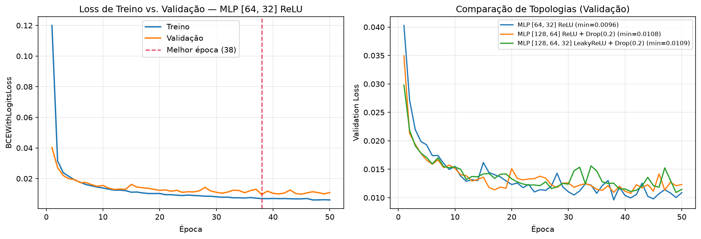
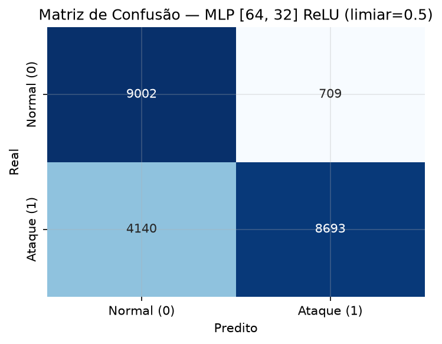

# Problema 2 — Rede MLP em PyTorch para Detecção de Ataques em Redes (NSL-KDD)

Os cálculos, gráficos e saídas completas estão no [notebook](problema2.ipynb).

## 1. Preparação dos Dados

- Os arquivos `KDDTrain+.txt` (125.973 amostras) e `KDDTest+.txt` (22.544 amostras) foram carregados com os 43 nomes de coluna especificados, descartando `difficulty_level`.
- Aplicou-se *one-hot encoding* em `protocol_type`, `service` e `flag` (alinhando o teste às colunas do treino), resultando em **122 atributos de entrada**.
- O rótulo foi binarizado (`normal` $\to 0$; qualquer ataque $\to 1$), resultando em **46,5%** de ataques no treino/validação e **56,9%** no teste.
- Reservou-se **20% de `KDDTrain+`** (25.195 amostras, `shuffle=False` no `DataLoader`) como validação e **80%** (100.778 amostras) como treino. A padronização *Z-score* dos 38 atributos numéricos foi ajustada exclusivamente nos dados de treino.

## 2. Arquitetura, Estudo de Topologias e Parada Antecipada

A classe `MLP(nn.Module)` foi implementada com camada de saída linear (1 neurônio, sem sigmoide), função de perda `BCEWithLogitsLoss`, otimizador `Adam` ($\text{lr} = 10^{-3}$) e *mini-batches* de tamanho `256` por **50 épocas**. Foram avaliadas três topologias:

| Arquitetura | Melhor Val Loss | Melhor Época | Train Loss (Ép. 50) | Val Loss (Ép. 50) |
| :--- | :---: | :---: | :---: | :---: |
| **`MLP [64, 32] ReLU`** | **`0.00960`** | **38** | `0.00607` | `0.01088` |
| `MLP [128, 64] ReLU + Dropout(0.2)` | `0.01076` | 41 | `0.00768` | `0.01231` |
| `MLP [128, 64, 32] LeakyReLU + Dropout(0.2)` | `0.01091` | 49 | `0.00763` | `0.01146` |

- **Escolha da topologia:** a arquitetura mais enxuta (`MLP [64, 32] ReLU`) atingiu a menor *loss* de validação (`0.00960`), indicando que duas camadas ocultas moderadas já capturam adequadamente as fronteiras não-lineares do tráfego de rede sem excesso de capacidade.
- **Necessidade de parada antecipada:** sim. Para a melhor arquitetura, a perda de validação atinge seu mínimo na **época 38** (`0.00960`) e volta a subir até `0.01088` na época 50, enquanto a perda de treino continua caindo (`0.00607`). Restaurar os pesos da época 38 evita esse início de sobreajuste.

## 3. Avaliação no Conjunto de Teste (`KDDTest+.txt`) e Limiar de Decisão

Avaliando a `MLP [64, 32] ReLU` (pesos da época 38) sobre `KDDTest+.txt` com limiar `0.5` sobre `sigmoid(logits)`:

| Métrica (Limiar = 0,5) | Valor |
| :--- | :---: |
| **Acurácia** | **78,49%** |
| **Precisão (Ataque)** | **92,46%** |
| **Recall (Ataque)** | **67,74%** |
| **F1-score (Ataque)** | **78,19%** |
| Verdadeiros Negativos (TN) / Falsos Positivos (FP) | `9.002` / `709` |
| Falsos Negativos (FN) / Verdadeiros Positivos (TP) | `4.140` / `8.693` |

A diferença entre a perda muito baixa na validação (~0,01) e a acurácia de 78,49% no `KDDTest+` é um comportamento clássico e esperado no benchmark NSL-KDD: o conjunto de teste contém **tipos de ataque inéditos (*zero-day*)** ausentes no `KDDTrain+`, o que produz um número expressivo de falsos negativos (`4.140`) com o limiar padrão de `0.5`.

### Análise Crítica: Falso Negativo vs. Falso Positivo e Ajuste do Limiar

- **Falso Negativo (ataque classificado como normal) — ERRO MAIS CRÍTICO:** uma intrusão real passa despercebida pelo IDS, podendo resultar em exfiltração de dados, indisponibilidade de serviços (DoS) ou comprometimento persistente da infraestrutura.
- **Falso Positivo (conexão normal classificada como ataque):** gera alertas indevidos (*alert fatigue*) ou bloqueio temporário de tráfego legítimo — inconveniente, porém muito menos danoso que uma invasão não detectada.

Como consequência, em produção **reduz-se o limiar de decisão abaixo de `0.5`** para priorizar o *recall* (detecção de ataques), aceitando um aumento controlado de falsos positivos. A tabela abaixo ilustra esse *trade-off* diretamente nos dados de teste:

| Limiar | Acurácia | Precisão | Recall | F1-score | FN (ataques perdidos) | FP (falsos alarmes) |
| :---: | :---: | :---: | :---: | :---: | :---: | :---: |
| `0.1` | **82,03%** | **92,70%** | **74,27%** | **82,47%** | **3.302** | 750 |
| `0.2` | 81,39% | 92,75% | 73,01% | 81,71% | 3.463 | 732 |
| `0.3` | 79,47% | 92,53% | 69,55% | 79,41% | 3.908 | 721 |
| `0.5` | 78,49% | 92,46% | 67,74% | 78,19% | 4.140 | 709 |
| `0.7` | 77,60% | 92,40% | 66,10% | 77,06% | 4.351 | 698 |

Reduzir o limiar de `0.5` para `0.1` eliminou **838 falsos negativos** ao custo de apenas **41 falsos positivos adicionais**, elevando o F1-score de `78,19%` para `82,47%`.
