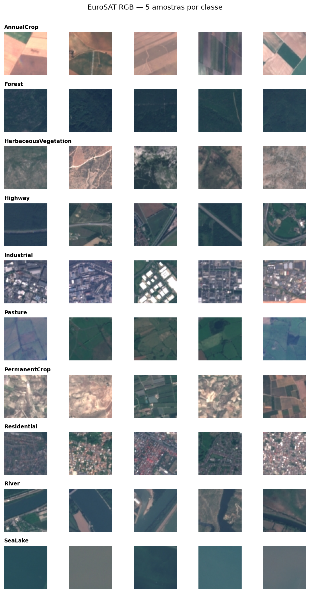
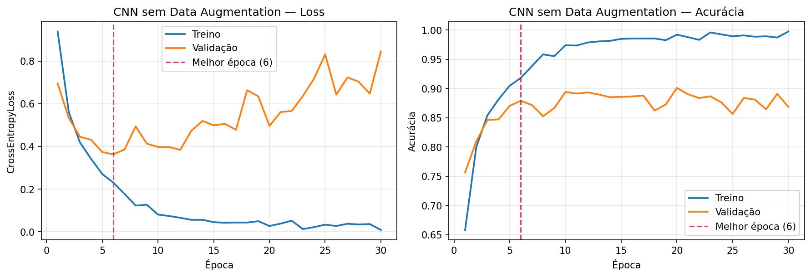
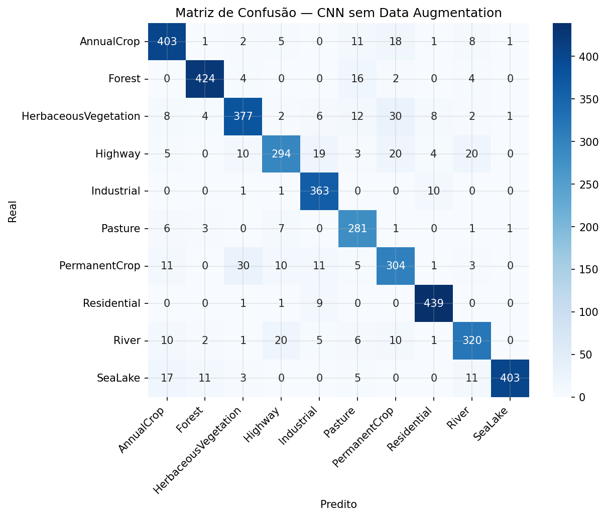
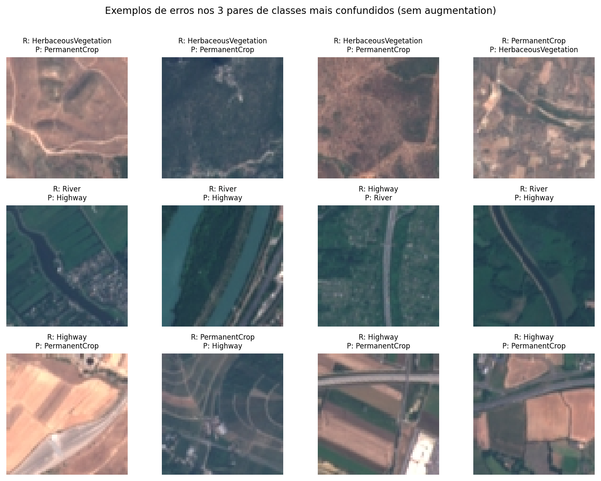
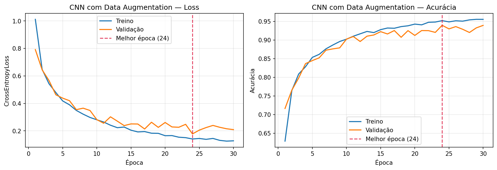
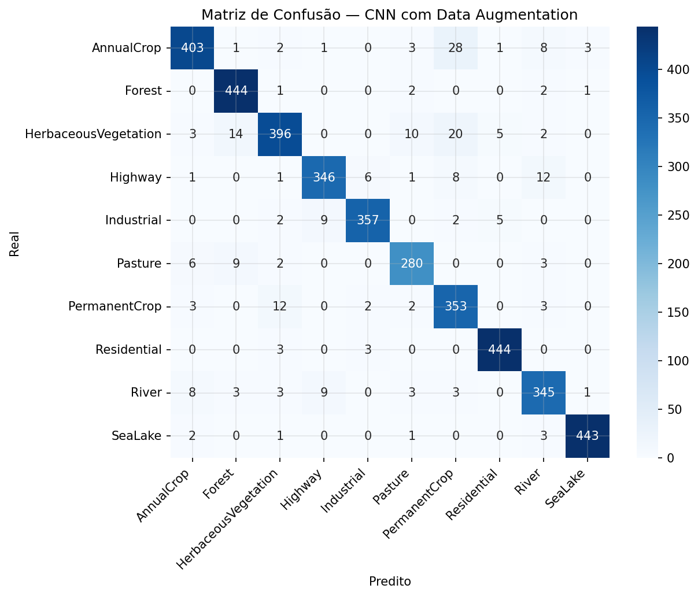

# Problema 3 — Rede CNN em PyTorch para Classificação de Uso e Cobertura do Solo (EuroSAT)

Os cálculos, gráficos e saídas completas estão no [notebook](problema3.ipynb).

## 1. Preparação dos Dados e Balanceamento

O dataset **EuroSAT RGB** contém **27.000 imagens** ($64 \times 64$ pixels, 3 canais) distribuídas em 10 classes:

| Classe | Imagens | Proporção (%) |
| :--- | :---: | :---: |
| `AnnualCrop` | 3.000 | 11,11% |
| `Forest` | 3.000 | 11,11% |
| `HerbaceousVegetation` | 3.000 | 11,11% |
| `Residential` | 3.000 | 11,11% |
| `SeaLake` | 3.000 | 11,11% |
| `Highway` | 2.500 | 9,26% |
| `Industrial` | 2.500 | 9,26% |
| `PermanentCrop` | 2.500 | 9,26% |
| `River` | 2.500 | 9,26% |
| `Pasture` | 2.000 | 7,41% |

**Discussão sobre balanceamento:** o conjunto é **moderadamente balanceado** — todas as classes têm volume expressivo (entre 2.000 e 3.000 imagens), com razão máxima/mínima de apenas **1,50×** (`3000 / 2000`). Esse leve desbalanceamento não compromete o treinamento com entropia cruzada padrão, mas justifica reportar o **F1-score macro** em conjunto com a acurácia global.

- **Split estratificado (`SEED = 42`):** 18.900 treino (70%), 4.050 validação (15%) e 4.050 teste (15%).
- **Normalização por canal (calculada apenas no treino em $[0, 1]$):**
  - $\mu = [0{,}3439,\; 0{,}3800,\; 0{,}4076]$
  - $\sigma = [0{,}2024,\; 0{,}1367,\; 0{,}1154]$
- **`DataLoader`:** *mini-batches* de 64 imagens, com embaralhamento (`shuffle=True`) apenas no treino.

## 2. Topologia da CNN

Foi implementada exatamente a arquitetura especificada:

$$\text{Input }(3\times64\times64) \to [\text{Conv}(32, 3\times3, p=1) \to \text{ReLU} \to \text{MaxPool}(2\times2)] \to [\text{Conv}(64, 3\times3, p=1) \to \text{ReLU} \to \text{MaxPool}(2\times2)]$$
$$\to [\text{Conv}(128, 3\times3, p=1) \to \text{ReLU} \to \text{MaxPool}(2\times2)] \to \text{Flatten }(8192) \to \text{Linear}(128) \to \text{ReLU} \to \text{Linear}(10)$$

Otimização com `Adam` ($\text{lr} = 10^{-3}$) e `CrossEntropyLoss` (sem `softmax` explícita na saída).

## 3. Treinamento sem *Data Augmentation* e Análise de *Overfitting*

Observa-se **forte sobreajuste (*overfitting*)** a partir da **época 6**:

- Na **época 6**, a perda de validação atinge o seu mínimo (**`0.3632`**, acurácia de validação de `87,90%`).
- Da época 7 até a época 30, a perda de treino cai continuamente até **`0.0087`** (acurácia de treino de **`99,75%`** — memorização quase total), enquanto a perda de validação **mais que dobra**, saltando para **`0.8454`** (acurácia de validação caindo para `86,86%`).
- A parada antecipada (salvando os pesos da época 6) mostrou-se indispensável para evitar a degradação severa de generalização.

## 4. Avaliação no Teste (Modelo Base) e Análise dos Pares Mais Confundidos

Utilizando os pesos da **época 6**, o modelo base atingiu **acurácia global de 89,09%** e **F1-score macro de 0,8877**:

| Classe | Precisão | Recall | F1-score |
| :--- | :---: | :---: | :---: |
| `AnnualCrop` | 0,8761 | 0,8956 | 0,8857 |
| `Forest` | 0,9528 | 0,9422 | 0,9475 |
| `HerbaceousVegetation` | 0,8788 | 0,8378 | 0,8578 |
| `Highway` | 0,8647 | 0,7840 | 0,8224 |
| `Industrial` | 0,8789 | 0,9680 | 0,9213 |
| `Pasture` | 0,8289 | 0,9367 | 0,8795 |
| `PermanentCrop` | 0,7896 | 0,8107 | 0,8000 |
| `Residential` | 0,9461 | 0,9756 | 0,9606 |
| `River` | 0,8672 | 0,8533 | 0,8602 |
| `SeaLake` | 0,9926 | 0,8956 | 0,9416 |
| **Média Macro** | **0,8876** | **0,8899** | **0,8877** |

### Três Pares de Classes Mais Confundidos

1. **`HerbaceousVegetation` $\leftrightarrow$ `PermanentCrop` (60 erros: 30 + 30):** ambas apresentam cobertura vegetal de porte baixo/médio com tonalidades verde-acastanhadas muito próximas no espectro visível (RGB). Sem as bandas do infravermelho próximo (NIR) do Sentinel-2, pomares/vinhedos (`PermanentCrop`) com espaçamento sutil confundem-se facilmente com vegetação herbácea natural.
2. **`Highway` $\leftrightarrow$ `River` (40 erros: 20 + 20):** ambos exibem **geometria fortemente linear** (faixas estreitas e contínuas cortando a imagem sobre um fundo rural ou vegetal). Em imagens de $64 \times 64$ pixels (10 m/pixel), rios estreitos/escuros e rodovias asfaltadas compartilham assinaturas espaciais e de contraste muito similares.
3. **`Highway` $\leftrightarrow$ `PermanentCrop` (30 erros: 20 + 10):** talhões de culturas permanentes frequentemente contêm estradas rurais vicinais, aceiros ou fileiras lineares paralelas bem marcadas, gerando bordas retilíneas que a CNN associa à classe `Highway`.

## 5. *Data Augmentation* e Comparação dos Modelos

O modelo foi retreinado do zero com a mesma topologia, hiperparâmetros e semente, aplicando `RandomHorizontalFlip(0.5)`, `RandomVerticalFlip(0.5)` e `RandomRotation(30)` **apenas no conjunto de treino**.

### Comparação Quantitativa (Sem vs. Com *Data Augmentation*)

| Critério | Sem *Data Augmentation* | Com *Data Augmentation* | Variação |
| :--- | :---: | :---: | :---: |
| **Época selecionada (parada antecipada)** | Época 6 | **Época 24** | +18 épocas de aprendizado útil |
| **Menor Val Loss** | `0.3632` | **`0.1777`** | **−51,1%** |
| **Gap de Loss na Ép. 30 (`val - train`)** | `0.8367` | **`0.0815`** | **−90,3% (redução de 10×)** |
| **Gap de Acurácia na Ép. 30 (`train - val`)** | `12,88 p.p.` | **`1,62 p.p.`** | **−11,26 p.p.** |
| **Acurácia Global no Teste** | `89,09%` | **`94,10%`** | **+5,01 p.p.** |
| **F1-score Macro no Teste** | `0,8877` | **`0,9397`** | **+5,20 p.p.** |

### Desempenho nos 3 Pares Mais Confundidos

| Par de Classes | Erros (Sem Aug) | Erros (Com Aug) | Redução |
| :--- | :---: | :---: | :---: |
| `HerbaceousVegetation` $\leftrightarrow$ `PermanentCrop` | 60 | **32** | **−28 (−46,7%)** |
| `Highway` $\leftrightarrow$ `River` | 40 | **21** | **−19 (−47,5%)** |
| `Highway` $\leftrightarrow$ `PermanentCrop` | 30 | **8** | **−22 (−73,3%)** |

O *data augmentation* atuou como um regularizador extremamente eficaz: impediu a memorização prematura do treino, permitiu que a rede continuasse aprendendo representações gerais até a época 24, reduziu o *gap* treino–validação em uma ordem de grandeza e elevou a acurácia no teste para **94,10%**, cortando quase pela metade (ou mais) os erros nos três pares mais difíceis.

### Por que essas transformações são adequadas para imagens de satélite — e por que não aplicá-las em validação/teste?

1. **Adequação a imagens de satélite:** imagens orbitais são capturadas em visada nadir (de cima para baixo), não possuindo uma orientação canônica privilegiada ("cima" ou "baixo" geográfico não altera o tipo de cobertura do solo). Uma floresta, uma rodovia ou um rio continuam pertencendo exatamente à mesma classe após espelhamentos horizontais/verticais ou rotações. Assim, essas transformações preservam integralmente o rótulo (*label-preserving*) e induzem invariância rotacional e reflexiva nos filtros convolucionais.
2. **Por que não aplicar em validação e teste:** os conjuntos de validação e teste têm a função de estimar o desempenho real do modelo sobre a distribuição original e não modificada dos dados. Aplicar transformações aleatórias nesses conjuntos introduziria ruído estocástico na avaliação (tornando as métricas não determinísticas entre épocas/execuções), dificultaria a parada antecipada e distorceria a comparação justa com outros modelos.
